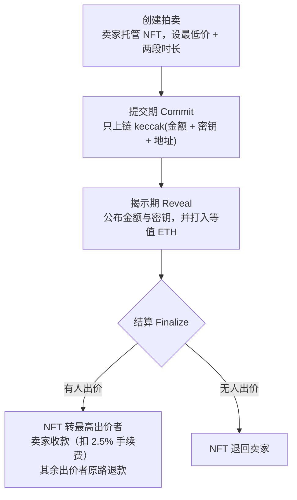

# 链上 NFT 市场 · 支持盲拍（Blind Auction）

基于 [Scaffold-ETH 2](https://scaffoldeth.io) 构建的 NFT 交易市场，除常规的挂单出售与议价外，核心特色是实现了**链上密封投标拍卖（Blind Auction）**——采用承诺-揭示（commit-reveal）机制，出价在揭示前对所有人（包括卖家和合约）不可见。

> ⚠️ 本项目为学习与演示用途，合约未经安全审计，请勿直接用于主网资金场景。

---

## 功能一览

| 模块 | 说明 | 位置 |
| --- | --- | --- |
| 🔒 盲拍 | 三阶段密封投标：提交承诺 → 揭示出价 → 结算交割 | `packages/hardhat/contracts/NFTMarketplace.sol` · 前端 `/blind-auctions` |
| 🏷 挂单出售 | 上架、改价、暂停/恢复、下架 | `/marketplace` |
| 💬 议价 Offer | 买家出价（带过期时间），卖家接受或拒绝 | `makeOffer` / `acceptOffer` / `cancelOffer` |
| 🎨 NFT 铸造 | 单个铸造、批量铸造、Excel 表格导入批量铸造 | `/myNFTs` |
| 📦 IPFS | 图片/元数据上传与下载 | `/ipfsUpload` · `/ipfsDownload` |
| 🔍 其他 | 我的 NFT、合集浏览、转账记录、合约 Debug 面板 | `/collections` · `/transfers` · `/debug` |

---

## 盲拍机制

### 为什么需要"盲"

公开拍卖里，后出价者能看到当前最高价，容易出现狙击（最后一秒加一毛钱）和跟风（看到别人出高价就抬价）。盲拍让**所有出价在揭示期之前都是密文的**，每个人只能独立判断这件 NFT 值多少钱。

### 三阶段流程



### 关键实现

**承诺哈希**

```solidity
commitment = keccak256(abi.encode(amount, secret, msg.sender));
```

提交期只有这个 32 字节的哈希上链，任何人无法反推出金额。揭示期合约会重新计算一次哈希，与之前提交的值比对，不一致则拒绝——所以出价后**无法篡改金额**。

**核心函数**（均位于 `NFTMarketplace.sol`）

| 函数 | 阶段 | 说明 |
| --- | --- | --- |
| `createBlindAuction(nftContract, tokenId, minBid, commitDuration, revealDuration)` | 创建 | NFT 立即托管进合约，保证卖家无法反悔 |
| `commitBlindBid(auctionId, commitment)` | 提交期 | 每个地址只能提交一次 |
| `revealBlindBid(auctionId, amount, secret)` | 揭示期 | 需 `msg.value == amount`，低于最低价则拒绝 |
| `finalizeBlindAuction(auctionId)` | 结算 | 卖家或合约 owner 触发，转账 + 退款一次完成 |
| `getAllActiveBlindAuctions()` | 只读 | 前端列表页读取未结算的拍卖 |

**资金流向**：提交期不锁任何资金；揭示期才把 ETH 打进合约；结算时赢家的 ETH 成为货款（扣除手续费后给卖家），输家的 ETH 原路退回。

**密钥保管**：前端把用户填写的密钥存在浏览器 `localStorage`（键名 `blind-secret-<auctionId>`），揭示期自动回填。清缓存或换设备会丢失密钥，导致无法揭示，请自行记录备份。

---

## 快速开始

### 环境要求

- Node.js >= v20.18.3
- Yarn（本项目使用 Yarn 3.2.3，已随仓库提供 `.yarn/releases`）
- Git

### 安装与本地运行

```bash
yarn install

yarn chain     # 终端 1：启动本地 Hardhat 节点
yarn deploy    # 终端 2：部署合约到本地链
yarn start     # 终端 3：启动前端 http://localhost:3000
```

首次部署会提示创建部署账户，按提示执行 `yarn generate` 即可。

### 其他常用命令

| 命令 | 作用 |
| --- | --- |
| `yarn compile` | 编译合约并生成 TypeScript 类型 |
| `yarn test` | 运行 Hardhat 测试 |
| `yarn lint` | 前端 + 合约代码检查 |
| `yarn format` | 格式化全部代码 |
| `yarn ipfs` | 启动本地 IPFS 节点（供上传功能使用） |

### 部署到测试网

```bash
yarn generate                    # 生成部署账户
yarn deploy --network sepolia    # 部署到 Sepolia
yarn verify --network sepolia    # 在 Etherscan 验证合约源码
```

部署私钥请写入 `packages/hardhat/.env`（参考同目录 `.env.example`）。**该文件已被 `.gitignore` 忽略，切勿提交到仓库。**

---

## 项目结构

```
packages/
├── hardhat/                 # 合约与部署
│   ├── contracts/
│   │   ├── NFTMarketplace.sol    # 市场 + 盲拍
│   │   └── YourCollectible.sol   # ERC721 示例藏品
│   ├── deploy/                   # 01 / 02 部署脚本
│   └── test/                     # 合约测试
└── nextjs/                  # 前端（Next.js 15 + App Router）
    └── app/
        ├── blind-auctions/       # 盲拍列表与三阶段操作
        ├── marketplace/          # 挂单市场
        ├── myNFTs/               # 铸造 + 我的藏品
        ├── collections/          # 合集浏览
        ├── transfers/            # 转账记录
        ├── ipfsUpload|ipfsDownload/
        └── debug/                # 合约调试面板
```

---

## 已知限制与改进方向

1. **提交期零成本**：不需要押金即可提交承诺，可能出现"只承诺不揭示"的虚假热度。可考虑提交时收取少量保证金，未揭示者罚没。
2. **退款失败会阻塞结算**：`finalizeBlindAuction` 中对每位出价者退款使用 `require`，若某个地址拒绝收款（如恶意合约），整个结算会 revert，NFT 与资金卡在合约中。稳妥做法是改为"待提取余额 + 用户主动 withdraw"（pull payment 模式）。
3. **结算需手动触发**：揭示期结束后必须由卖家或 owner 调用 `finalizeBlindAuction`。
4. **合约未审计**，且 `emergencyRecoverNFT` 等 owner 权限函数中心化程度较高，正式使用前建议引入多签并完成审计。

---

## 技术栈

Next.js 15 · React 19 · TypeScript · RainbowKit · Wagmi · Viem · Hardhat · OpenZeppelin · Yarn 3 Workspaces

底层脚手架来自 [Scaffold-ETH 2](https://github.com/scaffold-eth/scaffold-eth-2)，官方文档见 [docs.scaffoldeth.io](https://docs.scaffoldeth.io)。

## License

见 [LICENCE](./LICENCE)。
